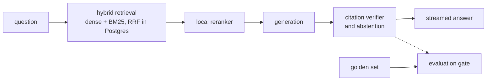

<h1>
  <picture>
    <source media="(prefers-color-scheme: dark)" srcset="apps/web/public/brand/lockup-dark.svg">
    
  </picture>
</h1>

**Tenancy-law answers with verified citations, over Dubai, Spain, Colombia and Florida law.** Legal information, not legal advice.

> **Status: early build, in public.** Plumbline is built gate by gate, and this README fills in as each gate passes: the results table, the live demo, the dataset and the harness land with the evidence behind them. Today the repository holds the contracts, the tooling and a stub answer that streams end to end.

Plumbline is a retrieval-augmented generation (RAG) system built evaluation-first. A 180-question golden set over the official statutes exists before the system does; every change passes a CI evaluation gate; and every number this README will publish rebuilds from committed model-output recordings, with no API keys and at no cost.

## What it does

- Answers tenancy questions in English, quoting each statute in its original language (Spanish for Spain and Colombia) with an English gloss.
- Checks every citation against the retrieved text, and drops the ones it cannot find.
- Declines when the indexed law does not answer the question, and answers in part when only part of it is covered.
- Answers for the law in force on a chosen date: editions, effective dates and struck-down provisions are data, not prose.
- Reads a lease and flags clauses that conflict with the statutes, each finding cited.

## Architecture



Details, contracts and ownership: [`docs/architecture.md`](docs/architecture.md). Decisions: [`docs/adr/`](docs/adr/README.md). The interface: [`DESIGN.md`](DESIGN.md).

## Quickstart

Needs Docker, [uv](https://docs.astral.sh/uv/), Node 22 and [pnpm](https://pnpm.io/) (pnpm can install Node itself: `pnpm runtime set node 22 -g`).

```bash
make setup        # git hooks, Python and JavaScript dependencies, Chromium for the e2e tests
make up           # Postgres (ParadeDB) and Redis
make api          # the API on :8000
make web          # the front end on :3000: ask anything and the stub answer streams back
make check        # everything the merge queue runs, in replay mode
```

`make help` lists every target.

## Repository

| Path | What |
| --- | --- |
| `apps/api/` | The API and the pipeline (Python 3.12, FastAPI, SQLAlchemy, Alembic) |
| `apps/web/` | The front end (Next.js, statically exported) on the Alined design system |
| `packages/rag-eval/` | The benchmark harness: golden-set schema, metrics, paired statistics |
| `packages/ts-client/` | Types generated from the OpenAPI schema, and the stream contract fixture |
| `packages/mcp-server/` | The corpus over MCP (planned) |
| `data/` | The corpus manifest, the golden set, synthetic leases |
| `evals/` | Configurations and results |
| `cache/` | Recorded model outputs, so evaluations replay at zero cost |

## Gates

| Gate | True when | Status |
| --- | --- | --- |
| 0 | `make up` streams a stub answer, CI is green on `main`, no secret has ever been committed, the self-review protocol is written | in progress |
| 1 | The corpus is indexed with counts, the reranker decision is recorded with numbers, the baseline results for A0 and A2 are committed | not started |
| 2 | 180 golden items frozen with a dev/test split, the judge's TPR and TNR at or above 80%, a red CI run on a regression linked | not started |
| 3 | The demo works on desktop and phone with axe clean, results with confidence intervals on dev, a failure taxonomy with one measured fix | not started |
| 4 | Red-team report, cross-tenant test, kill switch observed, live URL monitored, a backup restored, the runbook executed | not started |
| 5 | Every gold item verified, the answer audit and rubric review done, the test set run once and reported beside dev | not started |

## How it is built

[`AI_USAGE.md`](AI_USAGE.md) says what agents draft and what is verified by hand; [`docs/self-review.md`](docs/self-review.md) is the review protocol; [`AGENTS.md`](AGENTS.md) holds the rules every coding agent follows.

## Licence

Code: [Apache 2.0](LICENSE). Data: per source, in [`DATA_LICENSES.md`](DATA_LICENSES.md).
