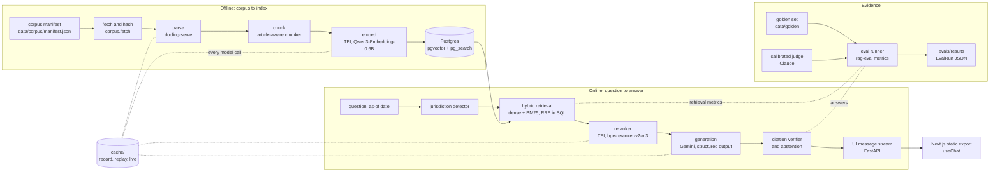

# Architecture

Plumbline answers tenancy-law questions from the official statutes of four jurisdictions, cites the article behind every claim, and declines when the indexed law does not answer. This page shows how the parts fit and which contract each boundary uses. It is frozen: a change is agreed in a brain block first.

## The system



## Boundaries and their contracts

| Boundary | Contract | Owner |
| --- | --- | --- |
| Corpus to everything | `plumbline.corpus.manifest.Source`: one edition of one law, with URL, hash and licence basis | B |
| Chunker to index and retrieval | `plumbline.core.types.Chunk`, keyed to `ArticleRef` | frozen |
| Retrieval to generation | `Retrieved` with every score (`RetrievalScores`) | frozen |
| Generation to API | `AnswerPipeline.stream(Question)` yielding `StreamEvent`s (`plumbline.core.stream`) | frozen |
| API to browser | the AI SDK UI message stream; payloads as `data-status`, `data-citation`, `data-answer`, `data-trace` parts, typed from `packages/ts-client/openapi.json` | frozen (`core/stream.py`), D (encoder) |
| System to benchmark | `rag_eval.schema`: `GoldenItem`, `RetrievedRef`, `EvalResult`, `EvalRun`, the `Retriever` protocol | frozen |
| Configuration | `plumbline.core.config.EvalConfig`, one YAML per configuration, identified by `config_hash()` | frozen (schema), A (files) |
| Every model call | `plumbline.cache.ResponseCache`, content-addressed recordings under `cache/<kind>/` | frozen |

The jurisdiction, language and answer-status enumerations live once, in `rag_eval.schema`, and `plumbline.core.types` re-exports them, so the published harness and the system cannot disagree.

## The answer stream

`POST /api/ask` takes the body `useChat` sends (the chat's messages, plus `as_of` and `jurisdictions`) and answers the latest user message on its own. The response is `text/event-stream` with `x-vercel-ai-ui-message-stream: v1`:

```
start → start-step → data-status (transient, any number) → text-start → text-delta… → text-end
      → data-citation (one per [n]) → data-answer → data-trace → finish-step → finish → [DONE]
```

A pipeline failure becomes an `error` part and the stream still finishes, so the browser never hangs. `packages/ts-client/fixtures/ask-stub.sse` holds the exact bytes of the stub's stream; the API's tests and the front end's end-to-end tests both run against it, so the contract cannot drift on either side.

## Record, replay, live

Every model call goes through `plumbline/cache.py`. A request (model, prompt or inputs, parameters; never a key) hashes to one file under `cache/<kind>/<key[:2]>/<key>.json`. Tests, the hub and CI replay: a miss is an error, so they need no keys and cost nothing. Lanes record while they build and commit the recordings with their branch, which is how every published number rebuilds with `make reproduce`. Production runs live: misses call the model and nothing is written.

## Point-in-time law

Each chunk carries its edition, `effective_from`, `effective_to` and a `status` (`in_force`, `repealed`, `struck_down`) with the source's own validity note. The as-of date filters retrieval in SQL; it is never left to the model.

## Serving and tiers

The API runs on a home server behind a Cloudflare Tunnel; the front end is a static export on Cloudflare Pages that calls the API from the browser (ADR-0002). A `DEMO_TIER` switch, stored in the settings table and flipped by an admin-token route, degrades from `full` (premium route on) to `free` (free-tier models only) to `static` (the export alone, serving stored answers for the golden questions).

## Where the code lives

| Path | What | Lane |
| --- | --- | --- |
| `apps/api/src/plumbline/core/` | the contracts above | frozen |
| `apps/api/src/plumbline/{settings,cache}.py` | settings and the model cache | frozen |
| `apps/api/src/plumbline/corpus/` | manifest, fetch, data validation | B |
| `apps/api/src/plumbline/{ingest,jobs,db,api}/` | parsing, job queue, database, HTTP | D |
| `apps/api/src/plumbline/{chunking,retrieval,eval}/` | chunker, retrieval, evaluation runs | A |
| `apps/api/src/plumbline/{generation,judge,leases,observability}/` | generation, judge, lease checker, tracing | C |
| `apps/api/src/plumbline/security/` | redaction, quotas, kill switch | P |
| `packages/rag-eval/` | the benchmark harness, published to PyPI | A (schema frozen) |
| `packages/ts-client/` | generated OpenAPI types and the stream fixture | D |
| `packages/mcp-server/` | `search_law`, `get_article`, `check_clause` over MCP | D |
| `apps/web/` | the Next.js front end | E |
| `data/` | manifest, sources, golden set, synthetic leases, parsed corpus | B, D |
| `evals/` | configurations, results, calibration, red team | A, C, P |
| `infra/`, `deploy/`, `.github/workflows/` | Terraform, deploy scripts, CI | P (eval gate: A) |
